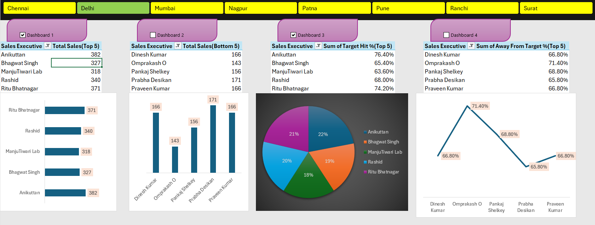

# Sales Performance Dashboard

An Excel-based sales performance dashboard for analyzing sales executives, regional performance, target achievement, and sales gaps.

## Project Overview

This project uses Microsoft Excel to turn sales data into a dashboard with KPI-style analysis and visual summaries.

The workbook contains:

- **Dashboard** sheet — visual sales-performance summary
- **Raw-data** sheet — underlying sales and target data

## Key Features

- Sales performance analysis by sales executive
- Regional sales analysis
- Total sales calculated from Day 1 to Day 5
- Target achievement percentage (**Target Hit %**)
- Gap analysis using **Away From Target %**
- Top 5 sales executives by total sales
- Bottom 5 sales executives by total sales
- Top performers based on target-hit and away-from-target metrics
- Excel charts and dashboard visualizations
- Formula-driven calculations for repeatable analysis

## Data Fields

| Field | Description |
|---|---|
| Emp Code | Employee identifier |
| Sales Executive | Sales representative |
| Region | Sales region |
| Day 1–Day 5 | Daily sales |
| Total Sales | Sum of five days' sales |
| Target | Sales target |
| Target Hit % | Total sales as a percentage of target |
| Away From Target % | Remaining percentage against the target |

## Tools Used

- Microsoft Excel
- Excel formulas
- Charts and data visualization
- Dashboard filters/controls

## Dashboard Preview

## How to Use

1. Download `dashboard1.xlsx`.
2. Open it in Microsoft Excel.
3. Go to the **Dashboard** sheet to view the analysis.
4. Use the available dashboard controls/filters to explore the sales data.
5. Open the **Raw-data** sheet to review the underlying records and formulas.

## Files

- `dashboard1.xlsx` — Excel sales performance dashboard
- `dashboard1.png` — dashboard preview image
- `README.md` — project documentation

## Purpose

This project demonstrates practical Excel skills in data organization, formula-based analysis, KPI reporting, and dashboard visualization.
